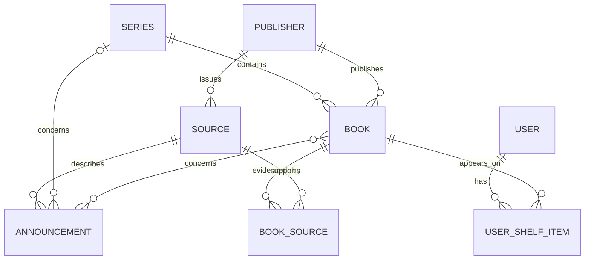

# ShelfPilot AI — Conceptual data model

This document describes the MVP entities and their relationships. It is a design note, not yet the JSON Schema contract. When implementation begins, define the canonical shapes in `schemas/` and keep the TypeScript types and fixtures aligned with them.

## Model overview

`Series` describes a publication line/work. A series does not have to have one permanent publisher; each published `Book` records the publisher for that specific publication. For the MVP, announcements concern series and/or specific books, with emphasis on volume and release updates.

## Entities

| Entity | Purpose | Core attributes |
|---|---|---|
| `Publisher` | Publisher/imprint that publishes a book or issues an announcement | `publisher_id`, `name`, `aliases[]`, optional `country`, optional `website_url` |
| `Series` | A work or publication line, independent of a single publisher | `series_id`, `canonical_title`, language tagged `titles` (Thai `th`, Japanese `ja`, English `en` when available), `aliases[]` for alternate names and search, optional `original_language`, optional `original_publisher_id` |
| `Book` | A specific volume in a specific publication/format | `book_id`, `series_id`, `publisher_id`, `volume`, `edition`, optional `title`, optional `isbn`, optional `release_date`, `release_status`, `sources[]` |
| `Source` | Evidence from a publisher announcement | `source_id`, `publisher_id`, `source_url`, `raw_text`, optional `published_at`. The demo source index resolves each ID to a local HTML section. |
| `Announcement` | The volume or release event described by a source | `announcement_id`, `source_id`, `type`, optional `series_id`, `book_ids[]`, `event_status`, optional `announced_at` |
| `BookSource` | The association between a book and an announcement/source that supports its details | `book_id`, `source_id`, optional `match_status` |
| `User` | A reader using the app | `user_id`, optional `display_name`, optional `preferences` |
| `UserShelfItem` | A user's ownership entry for a catalog book | `user_id`, `book_id`, `ownership_status`, optional `date_added` |

### Suggested controlled values

- `Announcement.type`: `volume_release` for the MVP; it may cover an upcoming or newly available volume.
- `Announcement.event_status`: values such as `announced`, `in_progress`, `on_sale`, `delayed`, `unknown`.
- `Book.edition`: retain the project contract values `manga`, `light_novel`, `special_set`, `big_book`.
- `Book.release_status`: `in_progress`, `announced`, `on_sale`, `delayed`, `unknown`.
- `BookSource.match_status`: retain `duplicate_merged`, `distinct_edition`, `needs_review`.

**ISBN note for the ingestion pipeline:** extract ISBN when it is present in an authorized source, and store it as optional metadata on the specific published `Book` edition/format. It may not be present in an early announcement; do not infer or generate it. Keep the internal `book_id` as the stable app identifier, and validate ISBN uniqueness for non-empty values in the catalog scope.

**Future extension:** licensing announcements and license records are outside the MVP. They can be added later as a separate event/workflow, since a license announcement may precede any volume or ISBN and has its own rights and publication-progress data.

## Relationship and identity rules

- A `Series` has many `Book` records. Each book record represents one volume and one edition; a manga and light novel adaptation must be separate series when they are separate publication lines, and their relationship can be added later if recommendations need franchise grouping.
- A `Book` points to the publisher actually publishing that specific volume/format.
- An announcement may reference a series and one or more books. A post listing multiple new volumes maps to one source/announcement linked to multiple book records.
- A source is the audit trail for an announcement. When a duplicate announcement confirms an existing book, append the source association to that book rather than creating another book. Uncertain matches go to review without changing the catalog.
- `book_id` remains the stable internal identifier for one volume/edition. ISBN is optional and is not the primary key: it identifies a published product/edition/format, not an individual copy, and may be missing before release. Capture it from source data when available; enforce ISBN uniqueness only for non-empty values in the appropriate catalog scope.
- `UserShelfItem` is a join record between users and books. Missing-volume calculations group owned books by the appropriate `series_id` and edition/publication line.

## Example MVP flow

1. A Thai publisher announces an upcoming volume. Resolve the `Series`, create or match the `Book` for its volume and format, and attach the announcement and source.
2. Extract the release date, sale status, and ISBN if they are stated in the source. Leave ISBN empty when absent; later authorized announcements can enrich the same book record.
3. If one post lists several volumes, link the same source/announcement to each corresponding book record.

## Demo source replay

The demo reads curated HTML pages stored in the repository. Each page recreates the factual fields needed for extraction and can contain several source sections. Read one section at a time and keep its original URL and source ID for provenance. Publisher volume announcements feed the release extraction flow. Shop listings and retailer references support catalog lookup and matching, with release details left empty unless backed by a release source.

For the local file layout, extraction steps, and websites to evaluate for live collection later, see [Demo data sources](demo-data-sources.md).
